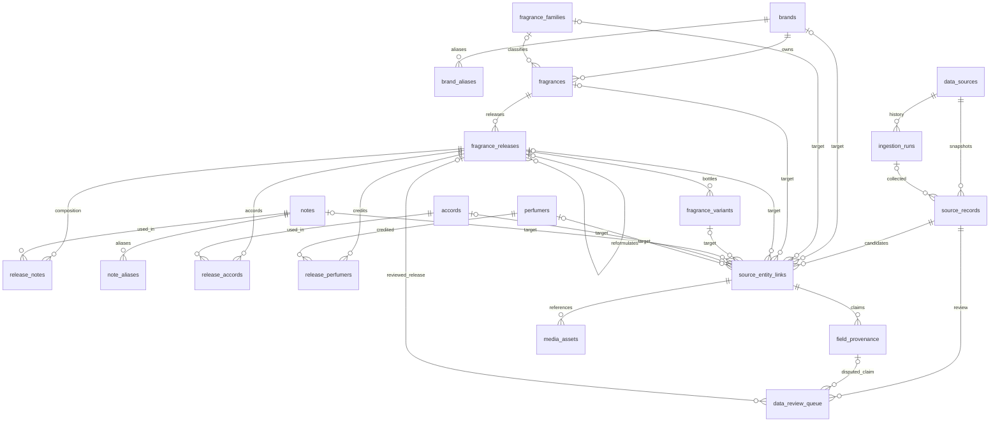

# Phase 2A database schema

The catalog uses PostgreSQL, SQLAlchemy 2 and Alembic. It prepares a future API and
multi-source ingestion without implementing either. Existing health/readiness,
version metadata, frontend mocks and seven disabled adapters remain compatible.
No source is approved by this schema or by the synthetic seed.

## Entity relationships

Each source link targets **exactly one** of the eight nullable canonical foreign
keys. This XOR is a database check; it is not an unenforced type/UUID polymorphic
reference. Each target and source record must exist. One canonical entity can have
many links from multiple records or multiple sources. Source/run composite foreign
keys prevent attaching a record to a run belonging to a different source.

A fragrance is a line, not a concentration or bottle. Releases preserve EDT/EDP,
version labels, original concentration labels and reformulation references. A
reformulation may reference only another release of the same line and cannot
reference itself. Variants preserve volume, original units, packaging and optional
GTIN/EAN independently; identical sizes and shared claimed identifiers are permitted.
Multi-hop reformulation cycle detection remains a future write-service concern.

## Identity, constraints and deletion

All twenty tables have application-generated UUIDv4 identities, TIMESTAMPTZ
created/updated times and explicit RESTRICT foreign keys. Fixture UUIDv5 identities
use permanent internal keys independent of names. No delete cascade or startup
`create_all()` is used. ORM updates maintain `updated_at`; direct SQL writers must
set it explicitly. PostgreSQL stores timezone-aware instants; intake contracts
require aware timestamps. Unknown verification timestamps remain null.

Named catalog objects have database-generated Unicode NFKC, whitespace-collapsed,
trimmed, lowercased lookup keys. Database generation prevents callers from supplying
forged keys. Blank normalized names are rejected. This is locale-aware lowercase,
not accent stripping or full Unicode case folding; aliases represent alternate
spellings explicitly. The database is the authority for key equality.

Brand/note/family/accord keys and slugs are unique. Aliases are unique per owner but
can be ambiguous across owners. Fragrance/perfumer names are indexed, not unique;
their slugs are unique route handles. Brand-key homonyms require explicit identity
review/disambiguation instead of automatic merging. Releases have no uniqueness on
name/concentration/year; variants have no uniqueness on size/GTIN. Composition pairs
are unique at their semantic scope (note + position, accord, person + credit role).
Unknown roles use PostgreSQL NULLS NOT DISTINCT to avoid duplicate unknown credits.

Year checks accept 1000–2999 as a deterministic broad intake range, not an invented
current/default year. Unusual historical claims outside this range require review
rather than silently changing the bound. Sizes must be positive, confidence and
accord strength in [0,1], positions top/heart/base/unknown, and orders nonnegative
when known. GTIN validates digits/allowed lengths, not checksum authenticity.

## Search and index choices

- B-tree unique/indexed normalized keys for exact brand, alias, note, perfumer and
  fragrance lookup; composite `(brand_id, name_key)` for brand-scoped matching.
- Foreign-key indexes support joins, reverse composition lookups and RESTRICT
  checks. Concentration and line/release years have B-tree indexes.
- A stored `to_tsvector('simple', name)` and GIN index provide built-in PostgreSQL
  lexeme search over fragrance names without stemming proper names. No copyrighted
  descriptions or unreviewed payloads are indexed. Brand search is separate; no
  cross-table denormalized trigger is introduced.
- Source record identity is unique on `(source_id, source_record_id, revision)`.
  `(source_id, collected_at)` supports synchronization windows. Source status,
  review status and `(entity_link_id, field_path)` support operational lookups.
- Each source link has a partial unique record/target index and target FK indexes.
  These preserve distinct links while preventing duplicate links to the same entity.

`pg_trgm` was evaluated for typo-tolerant ILIKE/similarity search, but is not installed
in Phase 2A: a later scoped search task should measure whether it is useful and
obtain extension-install permission. Supabase supports PostgreSQL extensions subject
to project/version policy; never assume the application role can install one. Native
full-text search needs no extension or privileged extension installation. No external
search service or paid search product was introduced.

A tiny synthetic dataset does not validate scale. Measure EXPLAIN (ANALYZE, BUFFERS)
with representative licensed data before adding composite/filter indexes. A planner
may correctly choose a sequential scan on fixture-sized tables. GIN increases write
and vacuum work. Limit application pools and avoid indexing entire unreviewed JSON
payloads. Future populated production tables may need separately planned concurrent
index creation; these transactional initial migrations are not a zero-downtime claim.

## Rights, conflicts and future matching

Source records are independent snapshots, never canonical entities. A payload may
be null until storage rights are verified; non-null JSON objects require approved
or explicitly synthetic storage status. Approved storage and redistribution each
require their own evidence reference. Public accessibility grants neither right.
Field claims preserve link → record → source attribution, claimed value/state,
collection time, versioned transformation history, rights snapshot/evidence and
nullable confidence. Multiple contradictory candidates can coexist without changing
the canonical value. No source has blanket field authority.

Pending/restricted/synthetic rights do not authorize public commercial distribution.
A selected internal claim is not an export license. Future API projections must
check current source and field rights, obligations, revocation and retention before
exposing values. Raw source payloads, descriptions, reviews and media never become
public automatically. Database checks record declared evidence, not proof that a
legal agreement is valid; trusted writers must verify the external evidence.

Review work references a record, optional claim and optional release. Cross-record
claims are allowed deliberately for multi-source conflict review. Resolution needs
reviewer, timestamp and nonblank decision. Evidence/agreements are references only;
do not commit private legal documents or credentials.

Future matching may use brand/name keys, concentration, year and validated product
identifiers. Conflicting concentrations, flankers and reformulations must remain
separate. Unknown identity fields or ambiguous scores enter review. This phase adds
no automatic linker, score-based merger or live collector. Media stores rights-aware
reference metadata only; storage paths require separate approved storage evidence.

## Migrations, seeds and future API mapping

- `0001_foundation`: unchanged Phase 1 history anchor.
- `0002_catalog`: twenty catalog/composition/provenance/media tables and constraints.
- `0003_search`: native full-text vector/GIN and source synchronization index.
- `0004_quality`: fixes boundary-whitespace normalization and requires redistribution
  evidence. It rebuilds only derived keys/indexes transactionally; canonical values,
  IDs and timestamps are retained. Collisions abort for review, never auto-merge.

No migration imports mutable model definitions, seeds demo content or contacts a
website. Alembic loads model metadata only for drift detection/autogeneration. The
schema uses PostgreSQL 15+ features (NULLS NOT DISTINCT), UTF-8 normalization,
JSONB and TIMESTAMPTZ; local validation uses PostgreSQL 17. Supabase compatibility is
schema-level reasoning, not a live hosted test or project modification.

Downgrades remove added schema/columns, including evidence and derived indexes, so
they are destructive and must be reviewed/backed up before any valuable-data use.
Round-trip tests operate only in randomly created loopback databases and require a
local CREATEDB test role; no reset/drop touches the application database.

The explicit demo CLI refuses production, remote targets and missing opt-in. UUID
upserts preserve existing rows/edits and never overwrite user data. Its fictional
sources are example.invalid references; no third-party catalog or image is fetched.
Seven registry candidates are copied only as disabled/pending policy rows.

Future `/api/v1/brands`, `/fragrances`, `/releases` and `/notes` resources can map UUIDs
and slugs to these tables, with allowlisted Pydantic projections, pagination and
rights filters. They are not implemented here. The separate Fraggy PWA should use
those eventual versioned API resources, never database credentials or source payloads.
Current frontend mocks remain isolated until that explicit integration task.
