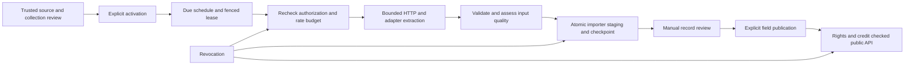

# Phase 2F collection architecture

Phase 2F extends the reviewed import foundation; it does not replace matching,
manual decisions, provenance, attribution or field-level publication. No public
collector/admin endpoint or application-startup scheduler is added.

## Modules and data flow

`apps/api/fraggy_api/collection/` contains:

- `policy.py`: strict endpoint/grant schemas, trusted operator review, digest and
  expiry verification against current source storage/attribution policy.
- `transport.py`: bounded GET requests, explicit external-network opt-in, public
  address validation, pinned TLS connections, credentials from named environment
  bindings, no redirects/cookies/ambient proxy or disabled TLS checks.
- `adapters.py`: REST JSON pages, JSON feeds/downloads, CSV feeds/downloads and
  HTML containing an explicitly selected `application/json#fragrance-data` block.
  Field mapping is source-specific reviewed configuration; no executable plugins,
  browser automation, guessed notes or automatic narrative extraction.
- `quality.py`: pre-staging Record validation and conservative Phase 2E duplicate
  classifications, missing/implausible metadata counts and explicit pair budgets.
- `engine.py`: disabled-by-default local scheduling, per-source request spacing,
  retries/backoff, leases, fencing, incremental checkpoints, page transactions,
  cancellation, monitoring and existing importer integration.
- `cli.py`: trusted non-production/loopback-database operator commands.

## Durable state and consistency

Migration `0005_collection` adds two tables. `collection_sources` holds reviewed
configuration/digest, private review history, independent enable/schedule flags,
frequency, next due/request times, private checkpoint and active lease token.
`collection_runs` holds status/times, cancellation flag, counts, bounded static
error summaries, input quality summary, configuration digest, ingestion-run UUIDs,
response SHA-256 digests and the checkpoint after committed pages. Full private
collection review evidence is retained in existing source evidence. Reports never
emit endpoints, credentials, bodies, cursors or private review evidence.

A short `FOR UPDATE SKIP LOCKED` transaction claims each source. A partial unique
index additionally prevents two running rows per source. Expired runs become
`interrupted` before a replacement token is issued. Every request and page write
checks the current token, lease, cancellation and source authorization again.
A stale worker cannot advance a replacement worker's checkpoint or finish its run.
No connection or database lock is held while sleeping or fetching HTTP.

Each extracted page is staged by the existing importer in the same transaction as
its checkpoint, counts, response hash and ingestion-run reference. Source policy
review/revocation and staging share the existing writer lock. Failed pages leave
no partial snapshots, counts or cursor movement; earlier committed pages remain.
A restarted run resumes at that cursor. Existing source-record/manifest content
digests provide idempotency and revision/change detection across runs.

REST envelopes use `records`, optional `next_cursor` and optional `watermark`.
Only `cursor` and `since` query parameters are constructed for the exact reviewed
endpoint. Checkpoints retain the previous completed watermark during a partial
cycle, then advance it only at cycle completion. ETags apply only to completed
single-page cycles and the same incremental query scope. No server-provided URL
can redirect collection to an unreviewed endpoint. Page and record budgets bound
runs; a page budget yields `partial` and a later run resumes.

## Existing boundaries

Incoming concentration spelling and source metadata remain in the import snapshot;
existing materialization normalizes canonical values after manual review. Brands,
fragrance lines, releases, concentrations, versions, notes/positions, accords,
perfumers and bottle sizes use the existing Record/matching/writing contracts.
Ambiguous products remain review candidates. Unsupported extra fields are rejected
unless a reviewed field map deliberately omits them. No descriptions, reviews or
images are added to the public API.

The existing seven website skeletons and registry remain unchanged, disabled and
pending. The collector uses separately reviewed file-import-compatible source
identities; reserved website IDs cannot enter that review path. No real source was
activated. Cross-page candidates are handled by existing staging/manual review;
pre-page similarity diagnostics are bounded and do not constitute entity identity.
